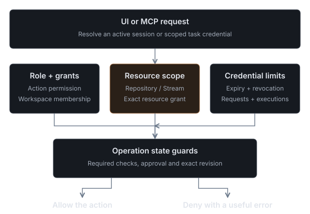

# Workspace administration

The self-hosted edition runs one workspace in the Cloudflare account that hosts it. The first administrator becomes its Owner. There is no public sign-up; the Owner creates or invites every other user.

## First administrator and MFA

Deploy with `ADMIN_EMAIL` and `ADMIN_PASSWORD` (12 characters or more). On the first visit, sign in with them, give a display name and a workspace name, then enroll a TOTP authenticator. Gitflare shows ten single-use recovery codes once; store them privately.

Every sign-in asks for an authenticator code; a recovery code works when the authenticator is unavailable. There is no automated MFA reset, Cloudflare SSO or platform-level super-administrator, so keep at least one Owner who can sign in.

`AUTH_ENCRYPTION_KEY` is generated at first deployment and kept on later ones. Back it up. If it is lost or changed, stored tokens and connections can no longer be decrypted.

## Users and permissions

In **Settings → People**, Owners create users or send single-use invitations. With a verified Cloudflare Email Sending sender configured, Gitflare emails the link; without one, pass the invitation link on yourself. Invitations expire after 24 hours and must match the invitee's email.

Roles are Viewer, Contributor, Reviewer, Triager, Maintainer, Deployer and Owner. Membership can be limited to selected repositories, and teams and per-resource grants refine it. Grants are authorization records only; they do not create secrets, databases or deployment credentials.

Browser sessions end after seven days without use and 30 days after sign-in; personal MCP tokens last eight hours. Ownership transfer, authenticator changes and new tokens require a sign-in within the last few minutes. When someone leaves, revoke their browser sessions, MCP sessions, agent credentials and open invitations.

Agent credentials are scoped to one repository with an expiry, a request budget and an execution budget. An agent never receives Owner, personal MCP or deployment credentials.

An MCP client acts with the signed-in person's current authority: it can approve or land only when that person's role and the candidate's state allow it. See the [MCP guide](mcp.md).

## Cloudflare account and resources

**Settings → Cloudflare** connects a Cloudflare account with a separate OAuth authorization. This is not sign-in; it never creates a Gitflare session. Before Cloudflare opens, Gitflare lists each permission it will request and why; [Cloudflare permissions](cloudflare-permissions.md) explains them and how to revoke access.

With an account connected, an Owner maps a repository to its Workers, D1 databases, Durable Object namespaces, Container applications and Workflows, each labelled with an environment. Resources are validated against the account before saving. Worker and D1 usage counters are shown; other types report unavailable rather than an estimate.

A D1 migration plan names one mapped database, the current repository revision and a SQL file under `migrations/` or `db/migrations/`, and records a SHA-256 checksum for review before the explicit execute step. If several D1 databases are mapped, choose the `databaseId`. Applying SQL can alter or delete data; inspect an uncertain outcome before planning another migration.

Mapping a resource never deploys a Worker or migrates a Durable Object. Workers Builds triggers and Durable Object migrations are not available. See the [overview](overview.md) for the current scope.
