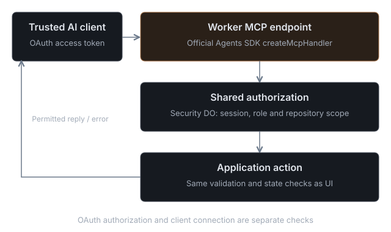

# Connect through MCP

Gitflare's MCP endpoint is `https://<your-worker-host>/mcp`. It runs on Cloudflare's Agents SDK MCP handler and every tool goes through the same access checks as the UI. A client gets the authority of the person who authorizes it, never a new role.

## Connect with OAuth

1. Add a remote MCP server in your client with your endpoint ending in `/mcp`.
2. Start the client's sign-in. The consent page shows the client's name, its callback host, the workspace and your role. A client name is self-reported, so check the callback host.
3. Choose an access level: **Read only** (`gitflare:read`), **Read and propose** (`gitflare:write`), **Approve and land** (`gitflare:land`) or **Full access** (`gitflare:admin`). Each level includes the ones before it and your workspace role still applies. A tool outside the level returns `INSUFFICIENT_SCOPE`.
4. List repositories and read one file. Confirm the workspace is the one you meant before authorizing writes.

Access tokens last one hour and refresh automatically; refresh tokens rotate on use. A connection lasts 30 days. Revoke it earlier in **Settings → Access → Account → Sessions**. Connections made before access levels existed keep full access until they expire.

Client-specific steps for Claude, Claude Code, Codex, ChatGPT, Cursor, VS Code, OpenCode, Windsurf, Zed and any other MCP client are on `/connect`, with configuration that already contains your server URL.

## Client callbacks

The authorization code is sent only to:

- an `https` address, such as Claude's, ChatGPT's, `https://vscode.dev/redirect` or Cursor's web callback;
- a loopback `http` address on your computer, such as `http://localhost:8787/callback` (Cursor), `http://127.0.0.1:33418/` (VS Code), `http://127.0.0.1:19876/mcp/oauth/callback` (OpenCode) or Claude Code's local callback, on any port;
- Cursor's app callback, `cursor://anysphere.cursor-mcp/oauth/callback`.

Other app-link schemes are refused because any local app can claim one.

Clients that cannot sign in with OAuth can use a personal MCP token from **Account → AI clients**. Keep it in the client's secure store or an environment variable; never paste it into a prompt, a repository file or a task.

## Claude and ChatGPT directories

Gitflare is not yet listed in Anthropic's connectors directory or OpenAI's plugin directory. Until it is, add the server by URL as a custom connector. A listing will use the same endpoint, sign-in and access levels.

- **Server URL**: `https://app.gitflare.io/mcp` for hosted Gitflare. `https://gitflare.io/mcp` redirects there with a 308. A self-hosted installation uses its own `/mcp`.
- **Sign-in**: OAuth 2.1 with PKCE (S256), Client ID Metadata Documents or dynamic registration, `iss` in authorization responses (RFC 9207).
- **Callbacks**: `https://claude.ai/api/mcp/auth_callback` (claude.ai, Claude Desktop, mobile and Cowork), Claude Code's loopback on any port, and ChatGPT's `https://chatgpt.com/connector_platform_oauth_redirect` or `https://chatgpt.com/connector/oauth/<callback-id>`.
- **Tool annotations**: every tool carries `readOnlyHint`, `destructiveHint`, `idempotentHint` and `openWorldHint`. Claude runs read-only tools without asking and asks before anything destructive: deleting, overwriting, cancelling, withdrawing an approval or changing a setting. Codex asks only for non-read-only tools when `default_tools_approval_mode = "writes"`.
- **Troubleshooting**: `INSUFFICIENT_SCOPE` means reconnect with a broader level. `RATE_LIMITED` gives a wait time. If sign-in fails on a revoked connection, remove the connector and add it again. Report other problems at `https://gitflare.io/support`.

## Tools

Every action in the UI has a tool, under the same authorization and state checks. Names are listed by your client's tool picker; the groups are:

| Area | Tools |
|---|---|
| Repositories | create, list, import a ZIP or Git URL, read files at a revision, streams, checkpoints, skills (`gitflare_list_repository_skills`, `gitflare_create_repository_skill`, `gitflare_update_repository_skill`) |
| Issues | list, open, comment, labels, templates, moderation (`gitflare_public_issues`, `gitflare_moderate_issue`, `gitflare_issue_labels`) |
| Missions | `gitflare_create_mission` (`mode` is `combine` or `race`), start, cancel, retry, `gitflare_select_candidate` for races, attempt history |
| Proposals and review | `gitflare_create_pull_request` (with `target: upstream` from a fork), `gitflare_review_mission`, approve, revoke approval, preview, land, `gitflare_run_checks` for a first-time contributor |
| Public repositories | `gitflare_visibility`, `gitflare_public_repository`, `gitflare_explore`, `gitflare_search`, `gitflare_star`, `gitflare_fork_repository`, `gitflare_sync_fork`, `gitflare_upstream_proposals` |
| Profiles | `gitflare_handles`, `gitflare_set_handle`, `gitflare_profile`, `gitflare_set_profile` |
| Inbox and notifications | `gitflare_inbox` (work waiting on you), `gitflare_notifications` (list, settings, subscriptions), `gitflare_manage_notifications`, `gitflare_submit_review` |
| GitHub | `gitflare_github_mirror`, `gitflare_github_import` (progress), `gitflare_import_github` (start, resume, cancel, hourly pull, make Gitflare canonical), `gitflare_github_organization`, `gitflare_import_github_organization`; tokens are entered in the browser only, `credential-setup` returns the URL |
| Community AI | `gitflare_fix_requests` (with `quote` to see who pays), `gitflare_request_fix`; Owners: `gitflare_community_pool`, `gitflare_manage_community_pool`, `gitflare_set_triage`; Triagers: `gitflare_triage_suggestion`, `gitflare_triage_issue`; reviewers: `gitflare_agent_review` (comments only); operators: `gitflare_operator_ai` |
| Releases and security | `gitflare_upload_release_asset`, `gitflare_delete_release_asset`; `gitflare_advisories`, `gitflare_manage_advisory` (private drafts), `gitflare_publish_advisory`; `gitflare_report_vulnerability` (private report to a public repository with a SECURITY.md) |
| Models | `gitflare_model_connections`; Owners: `gitflare_manage_model_connection` |
| Cloudflare | `gitflare_cloudflare_project`, `gitflare_manage_cloudflare_project` (map up to 100 resources, usage, D1 migration plan and execute), `gitflare_deploy_access`, `gitflare_manage_deploy_access` |
| Access | users, invitations, roles, teams, grants, sessions, audit log |

Public-repository, fork and profile tools work on hosted Gitflare only.

A few details worth knowing:

- Writes take an `idempotency_key`; replay the same request to reconcile an uncertain result.
- Approval and landing name an exact candidate and base revision. A stale base returns `STALE_PROPOSAL_BASE`.
- `gitflare_import_repository_archive` (Owner) accepts one base64 ZIP up to 5 MiB compressed, 500 files, 10 MiB expanded and 1 MiB per file, as the first revision of an empty repository. Call it with `dry_run: true` first: nothing is written, and the result lists `files`, `exclusions` (path, reason, `keepable`), `warnings` for imports of missing or skipped files, and an `install` suggestion. Secret, Git and dependency paths are always skipped; generated output only when it is clearly generated, and never when kept code imports it. Pass `keep` to import listed build output anyway and `enable_install` (Owner) to turn on dependency install for checks.
- D1 migration planning records a SHA-256 checksum of the SQL. Review it before the destructive execute step, and inspect an unknown outcome instead of retrying.
- Worker Builds triggers and Durable Object migrations are not available.

## Two kinds of credentials

A remote client acts as the person who authorized it. A coding agent started by a Mission gets its own scoped access to one fork. Never pass an Owner token, OAuth token, personal MCP token, deployment secret or setup token into an agent's sandbox.

See the [AI client guide](agents.md), [workspace administration](admin.md) and [repositories and changes](repositories.md).
