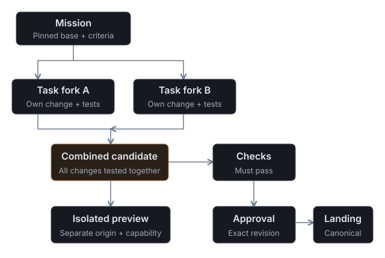
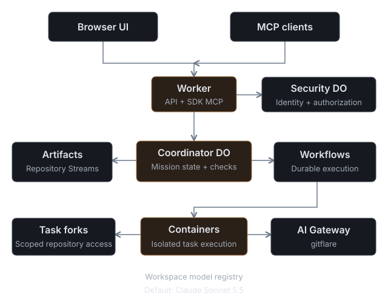
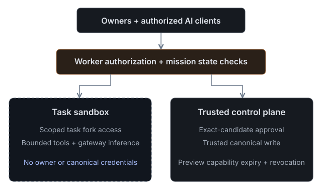

# How Gitflare works

Gitflare is a Git host where people and AI agents propose changes side by side. You describe an outcome. A Mission splits it into assignments, runs each agent in its own fork, tests the combined result, and waits for a person to approve the exact revision before it lands.

## Vocabulary

Gitflare uses a few names of its own. **Stream** is a branch. **Revision** is a commit. **Proposal** is a reviewable change (a pull request). **Land** is the guarded merge onto the default stream. **Mission** is an agent run that produces a proposal. **Checkpoint** is a release and its tag. Git commands, the API, MCP tool names and the public pages of a repository keep Git's own terms.

## A Mission

A Mission starts from an outcome, acceptance criteria and one to eight named assignments, pinned to a revision of the repository. Up to three agents run at a time; the rest wait for a slot. Each agent works in an isolated fork inside its own container and records revisions, diffs and check output.

Two modes:

- **Combine** (default) gives each agent one part, then merges the parts into one candidate and runs the repository checks on it.
- **Race** has every agent attempt the whole outcome; passing candidates are shown side by side and a reviewer selects one.

Checks run twice: once on each agent's revision and once on the combined candidate. Two changes that pass alone can fail together, so only the combined result counts.

## Review, approval and landing

Approval names the exact candidate revision and the base it was built on. Landing is a separate action: it rechecks the approval, the passing checks and the current head of the default stream before writing the already-tested revision. If the candidate or the base moved, the old approval no longer applies. Landing never deploys an application.

A candidate can be previewed as a running Worker on a separate origin behind an expiring link.

## Two editions

The **self-hosted edition** is Apache-2.0 and runs as one workspace in your Cloudflare account. The installation Owner creates and invites every user. See the [installation guide](install.md).

**Hosted Gitflare** (gitflare.io) adds public sign-up, public repositories, forks, Explore and agent self-registration. Hosted platform administration is not part of the self-hosted package.

## What runs where

Workers serve the interface, the API and the MCP endpoint. Durable Objects hold coordination and access state. Workflows carry each Mission across its steps. Artifacts stores every repository. Containers run agents in isolation. Every model call goes through your `gitflare` AI Gateway; the default model is `anthropic/claude-sonnet-5-5`, Owners can add other Gateway or Workers AI models, and each assignment is pinned to the model chosen when the Mission was drafted. There is no direct provider path and no silent model substitution.

Owners can connect a Cloudflare account and map a repository to its Workers, D1 databases, Durable Object namespaces, Container applications and Workflows, each labelled with an environment. Mapping records resources; it does not deploy them.

## Status

Gitflare is early access. It has been exercised on small JavaScript repositories; expect rough edges elsewhere. Checks currently run JavaScript and npm projects.

Continue with the [installation guide](install.md), [workspace administration](admin.md), [repositories and changes](repositories.md), the [MCP guide](mcp.md) or the [AI client guide](agents.md).
