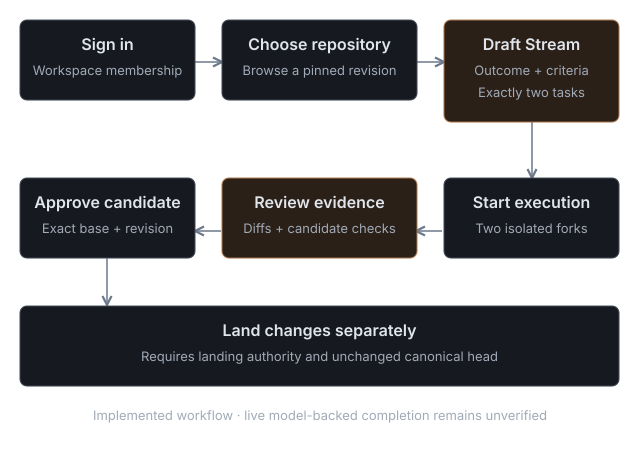

# Repositories and changes

## Creating a repository

Start a repository empty, from a ZIP, or from a public Git URL with full history (**Import from URL**: every stream and tag, up to 256 MiB of Git objects, 500 streams and 2,000 tags; a token you supply is used once and never stored). Repositories live in your Cloudflare Artifacts namespace, and you can also connect a repository that already exists there.

ZIP import is for an empty repository (or one holding only untouched Gitflare setup files). It needs repository Manage permission, checks the stream head again before writing, and accepts up to 5 MiB compressed, 500 files, 10 MiB expanded and 1 MiB per file. Secrets, Git metadata and installed dependencies (`node_modules/`, virtual environments) are always skipped. Generated output is skipped too: `coverage/`, framework caches such as `.next/` and `.turbo/`, and a `build/` or `dist/` folder only when the project declares it as output (a root `.gitignore` entry, `outDir` in a Vite or TypeScript config, Vite's default `dist/`) or it holds only bundle files (hashed or minified scripts, source maps, HTML, CSS, images, fonts). Build tooling source in `build/`, such as a Vite plugin, is imported. A skipped generated file that a kept file imports by relative path is kept as well. Unsafe paths are rejected, and the error for a file over 1 MiB names each such file. Before anything is written, the review step lists every skipped file with its reason, lets you tick skipped build output to import it anyway, and warns when a kept file imports a path that is missing or skipped. When `package.json` lists dependencies without a test script, the review offers to turn on dependency install for checks. Once source exists, change it through Missions or Git.

## Views

A repository has **Code**, **Issues**, **Proposals**, **Agents**, **Checks**, **Skills**, **Checkpoints** and **Streams**. Agents shows each run with its assignment, fork, revision, changed files and errors. Checks shows each agent's result and the combined result, with the revision each one covers. Skills lists `SKILL.md` files under `.agents/skills/`, `.claude/skills/`, `skills/` and `docs/skills/` at an exact revision, read-only. The skill editor writes `docs/skills/<slug>/SKILL.md` through a deterministic Mission that makes no model call; see the [AI client guide](agents.md).

## Missions

**New proposal → With agents** opens the Mission form. It shows the default stream and its latest revision, and submits that revision as the expected base. If the stream moved in the meantime you get a 409 and keep your draft; refresh the base and submit again. Creating a Mission saves a draft. Starting it pins the run to the revision current at that moment and spends compute and model usage.

A Mission has one to eight named assignments. **Combine** (default) gives each agent a part, shares assignments, notes and touched files between agents, then merges and tests the parts. **Race** needs at least two agents, each attempts the whole outcome, and a reviewer selects one passing candidate. Up to three agents run at a time; the rest wait for a slot.

### Repository policy

A root `gitflare.json` at the base revision sets the test command, the paths agents may edit, whether to install npm dependencies, a preview command, a test timeout (up to 900 seconds) and a runner size. Agents cannot change it. By default agents may edit `src/`, `docs/`, `public/`, `static/`, `assets/` and `README.md`; tests, test configuration, package manifests, lockfiles, `.npmrc` and `.github/` are protected. A starter repository's first Mission may add `gitflare.json` once.

Dependency install runs `npm ci --ignore-scripts` with network access limited to read-only requests to the npm registry. Checks themselves have no registry access, so installing inside a test command fails. Without an `install` in `gitflare.json`, an Owner can turn install on or off in Settings → Branches → Checks (**Dependency install**) or with `gitflare_set_check_settings` `install`: `npm`, `pnpm`, `yarn`, `auto` or `none`. `gitflare.json` at the base revision wins when it sets `install`; the change is audited. A test command that needs packages (`npm run …`, `npx`, `tsc`, `vite`, …) while install is off fails before running, with a message saying how to turn it on. Generated `node_modules/` is excluded locally in the sandbox; tracked dependency files stay protected. Checks either read a TAP report (`tap` evidence) or trust the exit code (`exit-code`), and the Checks view says which.

## Review and landing

Discussion attaches to the exact candidate revision, its base and the execution epoch. Reviewers comment or request changes; an unresolved request blocks approval and landing, and only the reviewer who raised it can resolve it.

Approve only the candidate and base revisions shown in the current evidence. Landing is separate: it rechecks the approval, the passing checks and the head of the default stream before writing the tested revision. Landing never deploys. Cancelled and retried attempts keep their own evidence.

Previews run on a separate origin behind an expiring link tied to the candidate; they are not public deployments.

The **Cloudflare** view lets an Owner map a repository to Workers, D1 databases, Durable Object namespaces, Container applications and Workflows from the connected account, each labelled with an environment. Worker and D1 usage counters are shown; other types report unavailable rather than an estimate.

## Public repositories and handles

Every account can choose a **handle** in Account → Profile, and a workspace Owner can choose one for the workspace in Settings → General. A handle is 1–39 lowercase letters, numbers or single hyphens; names used by Gitflare's own pages (such as `api`, `docs`, `settings` or `repository`) are reserved. Choosing your account handle creates your personal workspace. Renaming keeps the old address redirecting for 90 days, and nobody else can take the old handle during that time. A handle can change at most five times a day.

An Owner can make a repository **public** in Settings → General. Gitflare asks for a `LICENSE` file on the default stream, or an explicit choice to publish without one, and records the change in the audit log. A public repository lives at `https://<site>/<handle>/<repository>`: anyone can read its code, revisions, streams, checkpoints and issues without signing in. Anyone signed in can open issues and comment; proposals, Missions, discussions, secrets, previews, deployments and settings stay private to the workspace.

Links to a public repository, a profile or a releases page carry a preview card when shared on social networks and in chat: the name, description, language, stars, license, latest release and how many revisions landed in the last 30 days by agents and by people. The card is rendered at the edge from public records only; private repositories never get one.

**Issues on public repositories.** People outside the workspace open issues from the repository's templates (`.gitflare/ISSUE_TEMPLATE/*.md` or `.github/ISSUE_TEMPLATE/*.md`), comment, edit what they wrote and report content to the operator. Labels, assignees, closing, locking, hiding comments and blocking accounts belong to people who triage: the **Triager** role, Reviewers, Maintainers and Owners. Labels have colors and descriptions in Settings → Issues. A blocked account sees the repository's issues as not found. Outside accounts may post 10 times a minute; accounts younger than seven days may post 100 times a day and confirm they are human with Turnstile when the installation has it configured. Linked Missions are never shown publicly. Making a repository private again takes effect immediately; clones people already made stay with them.

Anonymous reads go through a public principal that can only read a repository marked public in its own workspace. A private repository, an unknown repository and an unknown handle all return the same `404`. Revision lookups on public pages cover the last 1,000 revisions of the default stream. Anonymous requests are rate-limited per address, and old `/repository/<id>` links to a public repository redirect signed-out visitors to its public address.

Anyone can clone or fetch a public repository over HTTPS without an account: `git clone https://<site>/<handle>/<repository>.git`. Pushing there asks for a personal token as the password (Account → AI clients); only workspace members with Contributor access can push, under the same stream protection as `/git/<repository>.git`. SSH is not offered. `/llms.txt` lists recently published public repositories.

## Explore, search, stars and profiles

**Explore** (`/explore`) lists public repositories by stars, newest or recently updated, and by language. **Search** (`/search`) finds public repositories by name, description or handle, people by handle or display name, and files by path; file contents are not searched. Signed-in accounts can **star** and **watch** public repositories; star counts are public and shape Explore. Every handle has a public **profile** at `https://<site>/<handle>` with a display name, bio, links, pinned repositories and its public repositories; a person's profile also lists what they starred. Edit yours in Account → Profile; an Owner edits the workspace's in Settings → General. Profiles show only what you enter, never your account name or email.

Explore and search read an index that is updated when a repository changes visibility, on every push and landing, on stars and on profile changes, and rebuilt nightly. Results are checked against the current public list before they are returned, so a repository that became private never appears. Anonymous public pages are cached at the edge for up to a minute; signed-in requests never are.

## Forks

Signed in, choose **Fork** on a public repository to copy its default stream into a workspace you own, usually your personal one. The fork is a private repository linked to its upstream, and the upstream counts its forks. Push streams to the fork over HTTPS with a personal token created while that workspace is open. Nobody outside the upstream workspace can push to the upstream itself.

The fork's Code tab shows where it came from and whether its default stream is up to date. **Sync** fast-forwards the default stream to the upstream head; it never merges, so a fork whose default stream has its own revisions should keep working on other streams. Each fork holds up to 1 GiB, counted from pushed and synced bytes. Forking is rate-limited to 10 forks an hour and 5 of the same repository a day. A private repository cannot be forked.

## Proposals from forks

On a fork, **Propose upstream** opens a proposal in the upstream repository from any stream of the fork. You need your own account; agent credentials cannot propose. Maintainers see it with their other proposals, marked with the fork it came from, and you follow it from the fork's Proposals tab under **Sent upstream**, where you can update it after pushing, close it or reopen it.

A first-time contributor's checks wait until an upstream Owner or Maintainer chooses **Run checks**. Once a maintainer has landed one of your proposals, later ones start their checks automatically under that maintainer's authority while they keep the role. Checks on a proposal from a fork run in a fresh sandbox from the fork's exact revision, read `gitflare.json` from the upstream base, and never receive the repository's secrets. Its preview runs only in an isolated container for at most an hour, never as a Worker Preview on a Cloudflare account. Approval still pins the exact candidate and base, the author cannot approve, and nothing reaches the upstream until a maintainer lands it. Proposals from forks are limited to 20 a day per upstream repository. If an upstream becomes private, its forks keep their code but lose the link and sync.

Public repositories are part of hosted Gitflare; the self-hosted and demo editions keep every repository private.

See the [AI client guide](agents.md), [MCP guide](mcp.md) and [installation guide](install.md).
